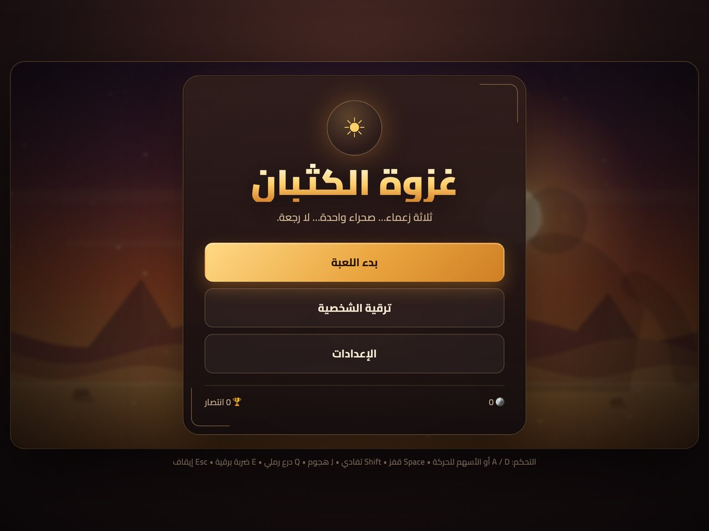
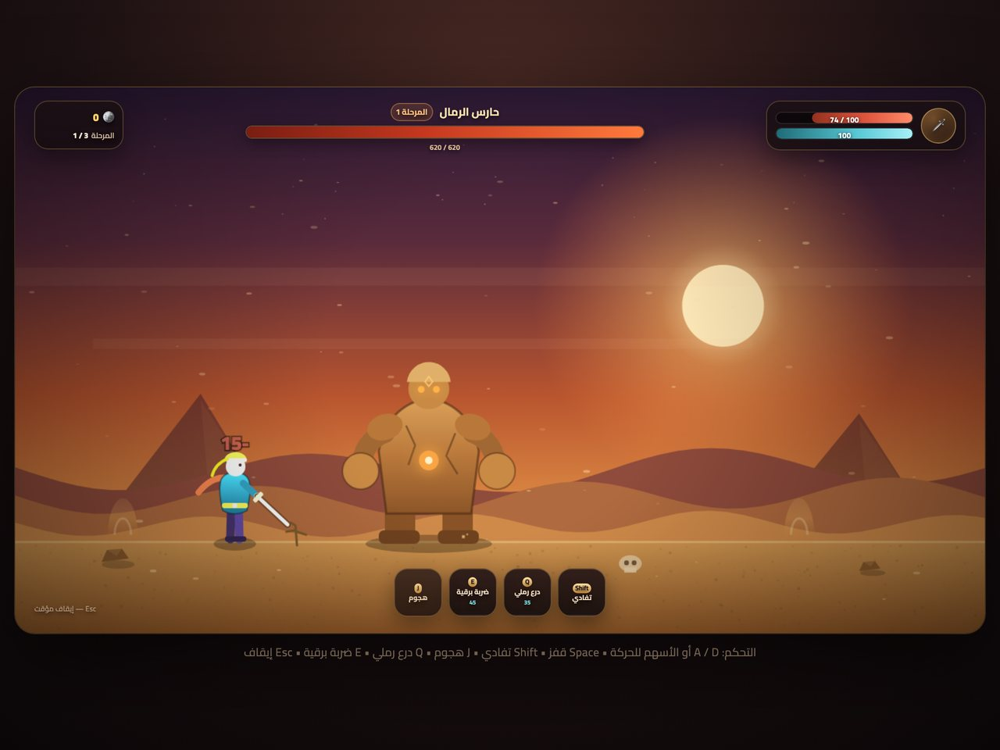
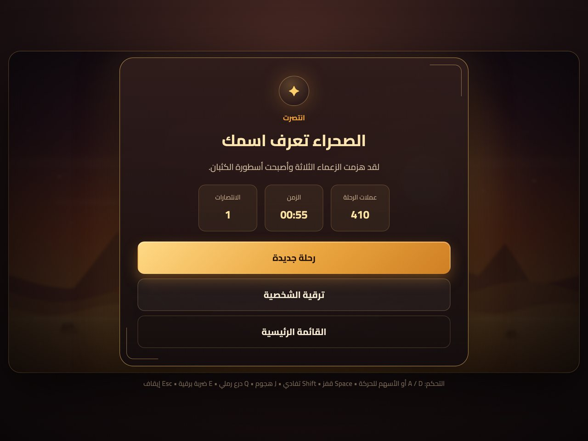

# غزوة الكثبان — Sandstorm Boss Rush

لعبة أكشن ثنائية الأبعاد عربية بالكامل، تُبنى على **HTML5 Canvas + JavaScript + CSS** دون أي مكتبات خارجية أو خطوات بناء. تقاتل ثلاثة زعماء في صحراء الغروب، تجمع العملات، وتطوّر شخصيتك بين المعارك.

<p align="center">
  
</p>

<p align="center">
  
  
  
  
  
</p>

---

## المحتويات

- [نبذة سريعة](#نبذة-سريعة)
- [البدء السريع](#البدء-السريع)
- [التحكم](#التحكم)
- [أبرز المميزات](#أبرز-المميزات)
- [الزعماء والمراحل](#الزعماء-والمراحل)
- [نظام التطوير](#نظام-التطوير)
- [بنية المشروع](#بنية-المشروع)
- [التخصيص والتوسيع](#التخصيص-والتوسيع)
- [الحفظ والبيانات](#الحفظ-والبيانات)
- [التوافق والاختبار](#التوافق-والاختبار)
- [المساهمة](#المساهمة)
- [الترخيص](#الترخيص)

## نبذة سريعة

| | |
|---|---|
| **النوع** | Boss Rush / Action Platformer 2D |
| **التقنيات** | HTML5 Canvas, Vanilla JavaScript (ES6), CSS3 |
| **اللغة** | واجهة عربية كاملة (RTL) |
| **التشغيل** | ملف واحد جاهز — بدون تثبيت أو Build |
| **الوسائط** | كل الرسومات إجرائية، والأصوات مولّدة عبر Web Audio |
| **الحفظ** | تلقائي عبر `localStorage` |



## البدء السريع

```bash
git clone https://github.com/sanadzerguin12580/Sanadgame.git
cd Sanadgame
```

ثم إما:

- افتح `index.html` مباشرة في المتصفح، أو
- شغّل سيرفرًا محليًا:

```bash
python3 -m http.server 3000
# ثم افتح http://localhost:3000
```

> لا حاجة إلى `npm install`. المشروع يعمل بفتح الملف مباشرة لأن الملفات تستخدم مساحة اسم `window.DG` وليس وحدات ES.

## التحكم

| الإدخال | الوظيفة |
|---|---|
| `A` / `D` أو `←` / `→` | الحركة |
| `Space` / `W` / `↑` | قفز (متغيّر الارتفاع) |
| `Shift` | تفادي سريع بمناعة لحظية (Dash) |
| `J` أو زر الفأرة الأيسر | هجوم السيف |
| `Q` | الدرع الرملي — 35 طاقة |
| `E` | الضربة البرقية — 45 طاقة |
| `Esc` | إيقاف مؤقت / استئناف |

نصائح: يمكنك صد المقذوفات بالسيف، والضربة البرقية تستهدف الزعيم تلقائيًا إذا كان قريبًا.

## أبرز المميزات

- **قوائم كاملة:** رئيسية، إعدادات،متجر ترقيات، إيقاف مؤقت، إنهاء مرحلة، نهاية اللعبة، وفوز.
- **HUD غني:** صحة اللاعب، طاقة المهارات، أسماء الزعماء وصحتهم ومراحلهم، العملات، ورقم المرحلة، مع مؤقتات انتظار مرئية.
- **قتال سلس:** حركة وتسارع، قفز متغيّر، تفادي بمناعة، هجوم بصد للمقذوفات، ومهارتان بموارد وتهدئة.
- **زعماء بمراحل غضب:** كل زعيم يغيّر أنماط هجومه عند 66% و33% من صحته، مع تحذيرات مرئية قبل كل هجوم.
- **تطوير دائم:** عملات ومتجر بأربع ترقيات قابلة للتكديس، تُحفظ تلقائيًا.
- **تجربة بصرية وصوتية:** خلفية صحراوية متعددة الطبقات، جزيئات، اهتزاز شاشة، أرقام ضرر، ومؤثرات مولّدة دون ملفات صوتية.
- **إعدادات:** مستوى الصوت، تشغيل/إيقاف اهتزاز الشاشة، وإعادة ضبط التقدم.
- **متجاوب:** يعمل على أحجام نافذة مختلفة، مع تصميم RTL كامل.

## الزعماء والمراحل

| # | الزعيم | المكان | Hp | أسلوب القتال |
|---|---|---|---|---|
| 1 | **حارس الرمال** | الواحة المنسية | 620 | موجات صدمة أرضية، صخور مقوسة، أعمدة رملية، ودوران غاضب في المرحلة الثالثة |
| 2 | **ملك العقارب** | وادي السموم | 860 | اندفاع عرضي، رشقات سم، استدعاء عقارب، ومطر سموم في المرحلة الثالثة |
| 3 | **ساحر الصحراء** | معبد الرمال | 1080 | انتقال وكرات متتبعة، شعاع أفقي، نيازك، وعاصفة رملية تدفع اللاعب |

قواعد التصميم داخل الكود: كل هجوم كائن مستقل يحتوي `windup` (تحذير)، `active` (تنفيذ)، `recover` (استراحة)، `cooldown`، و`phases`، مما يجعل الموازنة والتوسيع مباشرين.



## نظام التطوير

العملات تُكتسب عند هزيمة زعماء (+ مكافأة إضافية حسب الصحة المتبقية).

| الترقية | الأثر لكل مستوى | الحد الأقصى |
|---|---|---|
| الحد الأقصى للصحة | ‎+20 صحة | 10 مستويات |
| قوة الضربة | ‎+3 ضرر | 10 مستويات |
| تقليل وقت الانتظار | ‎-5% لمهارتي الدرع والبرق | 8 مستويات |
| تجديد الطاقة | ‎+2 طاقة/ثانية | 8 مستويات |

> تكلفة كل مستوى ترتفع تدريجيًا بنسبة نمو ثابتة، وتُحفظ الترقيات والعملات تلقائيًا.

## بنية المشروع

```text
.
├── index.html              # هيكل الصفحة، القوائم، HUD
├── css/
│   └── styles.css          # تصميم RTL، ألوان صحراوية، استجابة
├── js/
│   ├── utils.js            # DG.CONFIG ودوال الرياضيات المساعدة
│   ├── save.js             # الحفظ، الترقيات، الإعدادات
│   ├── audio.js            # مؤثرات Web Audio المولّدة
│   ├── input.js            # لوحة المفاتيح والفأرة
│   ├── effects.js          # الجزيئات، المقذوفات، الأخطار، الموجات
│   ├── player.js           # اللاعب والحركة والقتال والرسم
│   ├── bosses.js           # الزعماء الثلاثة والأتباع والمراحل
│   ├── ui.js               # القوائم والمتجر وتحديث HUD
│   ├── game.js             # حلقة اللعبة، الخلفية، إدارة المشاهد
│   └── main.js             # نقطة الانطلاق
├── docs/screenshots/       # لقطات التوثيق (JPEG خفيفة)
├── CONTRIBUTING.md
├── LICENSE
└── README.md
```

### تدفق اللعبة تقنيًا

1. `main.js` ينشئ `DG.Game` ثم `DG.UI`.
2. `Game` يدير آلة حالات: `menu → playing → paused / stageclear / gameover / victory`.
3. في كل إطار: تحديث اللاعب ← الزعيم ← الأتباع ← المقذوفات ← الأخطار ← الجزيئات، ثم رسم المشهد وتحديث HUD.
4. `DG.Save` يخزّن كل شيء في مفتاح `sand_boss_rush_save_v1`.

## التخصيص والتوسيع

| ما تريد تعديله | المكان |
|---|---|
| الجاذبية، الأرض، حدود الساحة | `js/utils.js` → `DG.CONFIG` |
| صحة/سرعة/أوقات هجمات الزعماء | `js/bosses.js` |
| إضافة هجوم جديد | أضف كائنًا إلى `this.attacks` مع `windup/active/recover/phases/range/cooldown/start/update/end` |
| إضافة ترقية | `js/save.js` → `DG.Save.UPGRADES` ثم `stats()` واستخدامها في `player.js` |
| الألوان والواجهات | `css/styles.css` |
| التوازن العام | `js/game.js` و`js/player.js` |

مثال مصغّر لهجوم جديد:

```js
myAttack: {
  windup: 0.6, active: 0.8, recover: 0.5,
  range: [0, 900], weight: 2, cooldown: 4, phases: [1, 2, 3],
  start: function (boss, game) { /* لحظة التنفيذ */ },
  update: function (boss, game, dt) { /* أثناء الهجوم */ },
  end: function (boss, game) { /* تنظيف */ }
}
```

## الحفظ والبيانات

- المفتاح: `sand_boss_rush_save_v1`
- البيانات: `coins`, `upgrades.hp/dmg/cd/energy`, `settings.volume/shake`, `stats.wins/bossKills`
- في وضع التصفح الخاص أو عند تعطيل التخزين، تعمل اللعبة لكن دون حفظ بين الجلسات.
- إعادة الضبط متاحة من شاشة الإعدادات داخل اللعبة.

## التوافق والاختبار

- متصفحات حديثة: Chrome / Edge / Firefox / Safari (دعم Canvas وWeb Audio).
- اختُبرت اللعبة فعليًا: الحركة، القفز، التفادي، الهجوم، الدرع، البرق، الإيقاف، هزيمة الزعماء الثلاثة، الانتقال بين المراحل، شاشتا الفوز والخسارة، شراء الترقيات، الحفظ بعد إعادة التحميل، وإعادة الضبط.
- فحص الصياغة:
  ```bash
  for f in js/*.js; do node --check "$f"; done
  ```
- ملاحظات: لا يوجد دعم لمس للهواتف بعد، ولم تُختبر المؤثرات الصوتية سمعيًا (تعمل برمجيًا دون أخطاء).

## المساهمة

المساهمات مرحّب بها! راجع [CONTRIBUTING.md](CONTRIBUTING.md) للخطوات وإرشادات الكود. افتح Issue لاقتراح زعيم جديد أو تحسين توازن، أو Pull Request لتعديل جاهز.

## الترخيص

هذا المشروع مرخّص تحت [MIT License](LICENSE).

---

<sub>صُنع بشغف للصحراء والألعاب العربية. إن أعجبتك اللعبة، لا تنسَ نجمة للمستودع ⭐</sub>
